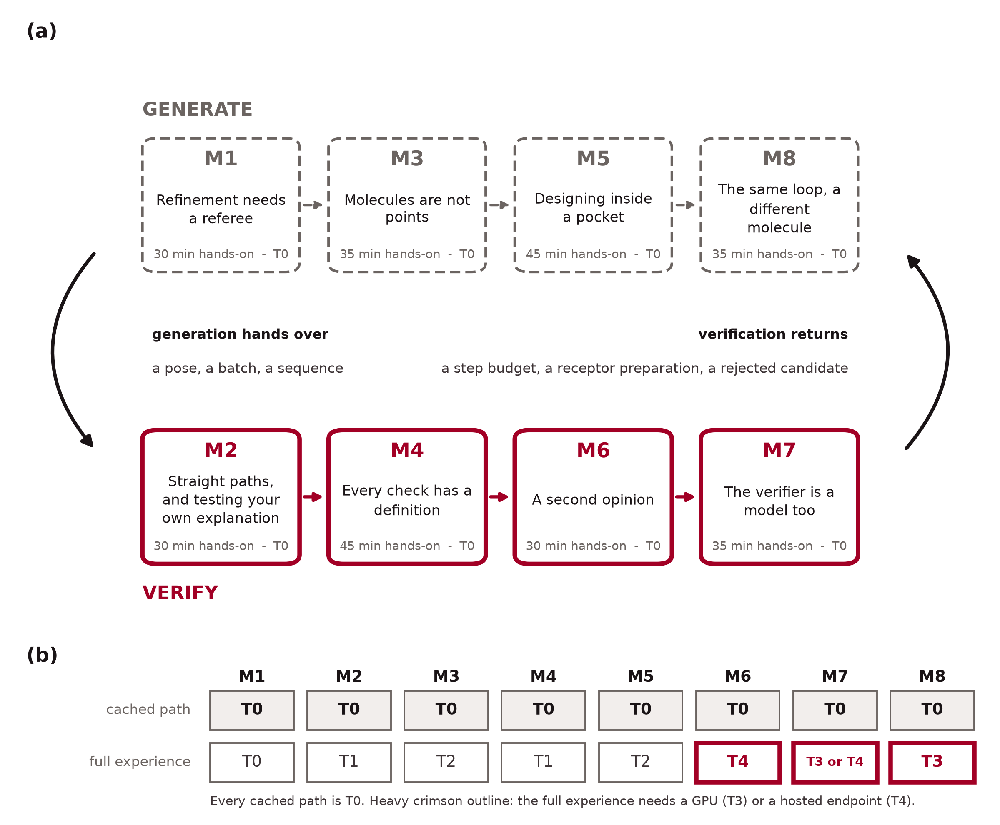

# Generate, then verify: a lesson guide

**Eight modules on pairing a molecular generative model with the checks that can fail it.**

Written for the NeurIPS 2026 Education Track by Noah Flynn. This guide is what an instructor
teaches from. It gives you, for each of eight modules, the one idea, the order to say things in,
the exact notebook cells and figures to open, the misconceptions that will show up in the room,
the discussion prompts, the exercise that follows, and what the module costs in minutes. It is
written to a colleague who is about to teach this, not to a learner.

Two sibling documents sit beside it and are not repeated here. `objectives_prerequisite_map.md` holds all
twenty-four objectives with their Bloom levels and their assessing exercises.
`assessment_blueprint.md` holds the full stem, starter state, expected answer and tolerance for
every exercise. When this guide says "X5", the specification is there.

A note on the numbers. Every quantity quoted below traces to a file that ships in this bundle, and
the caption or text beside it names the file and how to recompute it.
Where a number drifts between runs, this guide says so at the point of use rather than in a
footnote. That discipline is part of the subject being taught: a number you cannot reproduce is a
number you cannot defend.

---

## 0. The figure to put on the first slide

**Figure 1.** The eight modules of this curriculum, drawn as a closed loop rather than as a pipeline.
The upper arc carries the four modules where something is produced (a toy sampler, a 3D molecule, a
ligand inside a pocket, meaning a small molecule that binds to a protein, a protein backbone, which
is the chain of atoms running through a protein without the side chains that decorate it) and the lower arc, in crimson, carries the four whose job
is to test what came out. The two arcs close: generation hands over a pose, which is the specific
position and orientation of a molecule inside a pocket, or a batch or a sequence, and verification
returns a step budget, a receptor preparation or a rejected candidate. Panel (b) is the
compute honesty strip, one cell per module, cached path above and full experience below. Every cached
path is T0, meaning a laptop CPU reading files that ship in the bundle, with no GPU, no key and no
download; the three cells outlined in heavy crimson are the modules whose full experience needs a GPU
or a hosted endpoint, and each of those modules says in its own section what the cached path shows
instead. Vector copies for a poster or a slide deck are `figures/module_map.svg` and
`figures/module_map.pdf`.

The figure is the argument, so use it as the first slide of whichever configuration you run and come
back to it when you cross from an upper-arc module to a lower-arc one.

---

## 1. The concept, and why it is emerging

A model that invents molecules is half a system. It will hand you a picture of something that has
never been made, and the picture will look convincing. The other half of the system is everything
that decides whether the thing could exist and whether it would do the job: whether its atoms sit
at distances physics allows, whether a second, independent method puts it in the same place on the
target protein, whether a scoring model asked point blank will say it sticks at all. Teach only the
first half and a learner walks away able to produce candidates and unable to tell a real one from a
rendering.

This resource teaches the pair as one loop, and the pair is what emerged. The dates are checkable
and you should put them on a slide early, because a room that already knows what diffusion is will
otherwise assume it knows what this is about. Diffusion arrived in 2020 and flow matching, which trains a
network to predict a velocity that carries a noise sample along a chosen path to a data sample, in
2022. Both are settled machinery, and neither is the lesson. Filtering generated molecules is older
still: drug-likeness rules, docking scores and synthetic-accessibility estimates have screened
candidate structures for decades, and say so in the room, because a chemist in the
audience will know it and the claim here is narrower than it first sounds. What changed between 2023
and 2026 is narrower: a named, reproducible physical and structural
verification stack became something the field builds, reports and reads beside the generator, as one
system. PoseCheck (2023), a tool that
reports strain energy (how far a molecule's shape has been bent from the shape it would relax into)
and a protein-ligand contact profile for a pose, measured that pocket-conditioned generators, which
design a molecule while a protein pocket is held fixed and fed to the network as context, produce
more physical violations and fewer real contacts than conventional baselines. PoseBusters (2024), a battery of pass/fail geometric checks on a pose,
turned physical plausibility into a test any pose must clear, and found that deep-learning docking
methods, which predict where and how a given molecule sits in a given pocket, fail it. Boltz-2 (2025) put a co-folding model, one that predicts the structure of a protein and a ligand
together as a single complex rather than separately, and an affinity estimate at the end of the
pipeline, so the filter itself became a model with its own failure modes. FLOWR (2026) and TABASCO
(2025) are introduced by the PoseBusters validity they reach rather than by their loss curves.

That is the argument you are making when you teach this, and it has a practical form: a 2026 paper on molecular generation reports PoseBusters validity, strain energy, contact recovery
and a binder call, meaning a verdict on whether the molecule sticks to its target strongly enough to
matter, and a reader who knows only the sampler cannot read its results table. Your learners will be
able to.

Taught as a loop, the failures become the curriculum. Four of them run through the eight modules
like a spine, and each is something a learner measures rather than something you assert. A generator
can report perfect graph validity and still bend a molecule hundreds of times past the strain of a
real crystal pose. Two independent methods can agree on which pocket a design occupies and disagree
about the pose inside it by four angstroms; an angstrom is a tenth of a nanometre, and a
carbon-carbon bond is about 1.5 of them, so four is a few bond lengths. A receptor prepared one
plausible way fails every design, and prepared another way, most pass. An affinity number read below
the threshold where it is calibrated makes a rejected molecule look more potent than the drug that
is known to bind.

### The one design constraint

No module has an empty verify half. That is checkable, it is the property that makes the resource
about the loop rather than about diffusion, and it is the first thing to protect when you cut for
time. A configuration that keeps the generate arc and drops the verify arc teaches a different
subject with the same slides.

---

## 2. Who this is for, and what you need first

**Level.** Advanced undergraduate for modules 1 to 3; graduate for modules 4 to 8. State it at the
start of the session, because a learner who knows the level reads an unexplained step as one they
have not reached yet rather than as a gap in the material.

**Required.** Python fluency at the level of reading and modifying a function, indexing a DataFrame
and writing a loop. Basic probability: what a normal distribution is, what sampling from one means,
what a mean and a median are. Numpy and pandas at reading level, because every exercise reads a
shipped table.

**Assumed lightly.** That a network is trained by minimizing a loss with gradient descent. Nobody is
asked to design an architecture; the training loops are read, not written.

**Helpful, not required.** Calculus. Module 2 introduces an ordinary differential equation as a
current that tells a particle where to drift next, and uses the bluntest integrator there is.

**Not required: chemistry or structural biology.** This claim carries the whole leveling section and it is worth defending in the room, because a chemistry-free audience will
assume otherwise and disengage early. Eleven terms carry the entire chemical content, and
each is defined in one clause where it first appears. They are short enough to print on a card and
hand out, which is what the list below is for. Treat the list as the chemistry on-ramp: spend the
first few minutes of M3 walking it rather than assuming it, because that is the module where a
chemistry-free learner first meets a real molecule and the one place the vocabulary load spikes.

- **ligand**, the small molecule that binds to the protein
- **binding pocket**, the cavity on a protein's surface where a ligand sits
- **binder**, a molecule that sticks to its target strongly enough to matter
- **QED**, one number from 0 to 1 summarizing how drug-like a molecule looks, where higher is more drug-like
- **synthetic accessibility**, an estimate from 1 to 10 of how hard a molecule would be to make, where lower is easier
- **valence**, how many bonds an atom is allowed to have, so breaking it makes a molecule impossible rather than merely unusual
- **pose**, the specific position and orientation of a ligand inside a pocket
- **strain energy**, how far a molecule's shape has been bent from the shape it would relax into, in kcal/mol
- **angstrom**, a tenth of a nanometre, so a carbon-carbon bond is about 1.5 of them
- **co-crystal structure**, an experimentally measured structure of a protein with a ligand bound, the closest thing to ground truth in this material
- **protein backbone**, the chain of atoms running through a protein, without the side chains that decorate it

`glossary.md` tiers all fifty-four terms in the material and marks which are safe in an opening
paragraph.

**Models are introduced before they are used.** None of the generative or structural models this
curriculum runs is a prerequisite, so each is introduced in its own module before the module asks a
learner to read its output, and the model on-ramp budget in `INSTRUCTOR_NOTES.md` section 5 sets the
minutes each introduction needs, what it must establish, and what to keep out of it. A learner never meets an evaluation and an unfamiliar model in the
same breath: the diffusion and flow-matching toys are built in M1 and M2, FlowMol3 is introduced in
M3, DiffSBDD in M5, DiffDock in M6, Boltz-2 in M7, and RFdiffusion, ProteinMPNN and ESMFold in M8,
each with a one- or two-sentence account of what it does before any number it produces is read.

**Not required: a GPU, an API key or a cloud account.** Every module has a path that runs on a
laptop CPU against seventeen shipped data files totalling 722,824 bytes, with no download and no
credential. Two modules cannot be re-run at full scale by anyone without an A100-class GPU, and this
guide says which, where, and what the cached path shows instead.

---

## 3. What a learner can do at the end

The full set of twenty-four objectives, each with a Bloom level, a module and an assessing exercise,
lives canonically in `objectives_prerequisite_map.md`; the six below are the summary, not a second
copy to maintain. Six of the twenty-four carry the concept. Lead with these; the other eighteen are
the scaffolding that carries a learner to them.

1. Measure a sampler's failure rather than describing it: find the step budget at which output stops matching the target, and report the number that caught it. (M1, X1)
2. Separate a claim from its confound: name what else differs between two samplers besides the property under test, run the control, and report what the controlled measurement shows. (M2, X2)
3. Explain why a 100 percent graph-validity result says nothing about geometry, and name two geometric failures a valid graph can carry. (M4)
4. Discover unaided that six of nine intermolecular checks in a published table could not have failed, by measuring the receptor instead of trusting the table. (M4, X5)
5. Compute a potency estimate outside its calibrated range, observe that a rejected molecule looks more potent than a known drug, and say why. (M7, X10)
6. Map the loop onto a paper they have not seen: name its generator, its verifier, and the number the verifier reports. (M8, X12)

Objectives 4 and 5 are the two moments where a learner discovers a failure instead of reproducing a
success. If you cut everything else, keep those.

---

## 4. How to use the module walkthroughs

Each of the eight sections below has the same seven parts, in the same order, so you can teach from
any one of them without reading the others.

**The one idea** is what a learner should be able to say a week later. **The teaching narrative** is
the order to say things in, written as guidance rather than as a script. **What to open** names the
the exercise it feeds and the figure by its file stem, because the two
numbering schemes do not agree and guessing costs you a minute in front of a room. **Misconceptions
and discussion prompts** are a pointer rather than content: both live in `INSTRUCTOR_NOTES.md`
section 4, where each prompt is printed immediately above its expected answer, so a lecturer
preparing a session works from one file rather than two. **The exercise** points at the blueprint. **Timing and compute** gives the demo and hands-on minutes and states
plainly what the cached path does and does not give you.

---

## 5. The eight modules

### M1. Refinement needs a referee

**The one idea.** A generator that refines can correct its own mistakes, and the moment you let it
refine you need a number that can tell you it failed. The step budget is the dial; the energy
distance is the referee.

**The teaching narrative.**

Open on the frustration rather than on the algorithm. An autoencoder decodes a molecule in one
forward pass, so every mistake is a final mistake, and there is no moment at which a half-formed,
slightly wrong structure can be nudged back. That is the sentence the rest of the module answers.
Iterative refinement is the answer, and a diffusion model is the version of it you build here: a
generator trained to reverse a process that gradually turns data into noise, so sampling starts from
noise and takes dozens or hundreds of small denoising corrections, giving the model a chance to fix
what it got wrong two steps ago.

Then build it, on two dimensions, on a target the room can see in full. The two-moons dataset earns
its place: it is the only point in the curriculum where a learner can look at the ground truth and
the samples side by side and judge the result by eye. Use that while
you have it, because from module 3 onward nobody can.

Go forward first. The forward process dissolves the data into static, and the useful thing about it
is that you never have to simulate it: the noised sample at any level is a closed-form weighted sum
of the data sample and one Gaussian draw. Show the six-panel dissolution (the `forward_noising` figure) and ask which
of the two weights dominates at each end. Then reverse: the network is handed a noisy sample and its
noise level, and it predicts the noise that was added. That is the whole training objective. Say it
plainly, because learners expect something more elaborate.

Sample, and let the 200-step run succeed. Panel (a) of the `reverse_denoising` figure carries a Gaussian starting cloud back onto the two crescents. Then introduce the second sampler, DDIM, a deterministic
sampling rule for an already-trained diffusion network, run on the same trained network with no
retraining, which is the first appearance of a move this curriculum repeats:
the sampler and the trained model are separable, and swapping one changes the answer.

Now the part that makes this module module one rather than an introduction. Shrink the step budget
and watch it break. The moons fray at 8 steps and collapse into a diffuse blob at 4. Before you show
the number, ask the room to rank the panels by eye. They will do it confidently and they will be
roughly right, and that is the setup: on a two-dimensional target eyes work, and this is the last
time in the whole curriculum that eyes work. So introduce the energy distance here, a single number measuring how far one cloud of points sits
from another and zero when the two are indistinguishable, while its verdict can still be checked
against intuition. Show that it agrees with the eye
ranking. That agreement is what buys it trust for the seven modules where nobody can look.

Close with the definition the curriculum runs on: a generator is a sampler plus the measurement that
can fail it, and you have now built both.

**What to open.** Work the teaching narrative above alongside exercise `EX1` (task X1). Figures:
`forward_noising` for the forward dissolution at six noise levels, and `reverse_denoising` for the
successful 200-step run in panel (a) and the collapse under shrinking budgets in panel (b).

**Figure caution.** Panel (b) of the `reverse_denoising` figure prints a per-panel energy distance that traces to a file
this bundle does not ship, and no seed in either shipped sweep reproduces it. Do not read a number
off that panel. If you want the numbers on the slide, relabel from `data/toy_sampler_sweep.csv`,
where the seed-mean energy distance at an 8-step budget is 0.0407 for the ancestral DDPM sampler
(a denoising diffusion probabilistic model sampled with fresh noise added back at every reverse
step) and 0.00998 for flow matching. This is not a blemish to hide; if you have time, show the room that you caught it,
because it is the same failure mode module 4 is about.

**Misconceptions and discussion prompts.** The wrong models learners arrive with in this
module, and the prompts for the room, are in `INSTRUCTOR_NOTES.md` section 4 under M1, each
prompt printed beside its expected answer.

**The exercise.** X1, "Find the step budget where the sampler breaks", 12 minutes, introductory.
Learners predict, then sweep budgets of 200, 32, 16, 8 and 4, and report the smallest budget whose
energy distance stays under the 0.01 band. Ancestral DDPM crosses at 32 steps. The prediction step
is graded for being made, not for being right.

**Timing and compute.** 15 minutes as a demo, 30 minutes hands-on. Cached tier is the CPU-only
cached path, and so is the full experience: this is the only module where those are the same thing.
Module 1's toy sampler reads no data file at all and trains toy sampler inline in about three minutes on any
laptop. Nothing is lost, nothing is downloaded, and no credential is involved.

---

### M2. Straight paths, and testing your own explanation

**The one idea.** Flow matching reaches the same quality in a quarter of the steps, and the reason
you first reach for is not the reason that survives a controlled test.

**The teaching narrative.**

This is the module that teaches what verification is for, and it is the one instructors are most
tempted to cut. Cutting it is defensible in an hour, and it costs more than it looks like it costs,
because every later module repeats the move this module establishes.

Start with the mechanism, briefly, and state the comparison precisely, because it is easy to say
loosely and the loose version is wrong. You are not retraining one network on a new objective. You
are comparing two separately trained checkpoints that share one architecture, one width, one depth
and one parameter count, and differ only in what their output is regressed onto. The diffusion
checkpoint was trained to predict the noise that was added. The flow-matching checkpoint was trained
to predict a velocity, the direction and speed that carries a noise sample along a straight line
toward a data sample. Those are different quantities, a noise estimate and a velocity field, so the
two checkpoints are different objects that happen to be parameter-matched; the fair name for the
experiment is a parameter-matched comparison, not "the same network on a different target". Holding
the architecture fixed is what lets you attribute a difference in behaviour to the training target
rather than to model capacity, and that is the only reason the comparison is informative at all.
Sampling, correspondingly, stops being a reverse random walk and becomes following a current: the
field tells a leaf on a river where to drift next, and integrating it is stepping along the current.
Forward Euler, the crudest integrator there is, assumes the current is constant across a step and
moves along it. Use the crude one deliberately; it makes the step budget the honest variable.

Then the result. On the identical target, with two parameter-matched checkpoints, flow matching
crosses the 0.01 quality band at 8 steps where ancestral DDPM needs 32, a fourfold advantage. Put the band on the slide beside the ratio, and say why: the two curves are not parallel, so the ratio is a statement
about a threshold rather than about the samplers. At a 200-step budget the same two samplers sit
0.00147 and 0.00177 apart, a ratio of 1.2. Same architecture, same data, one number is 4 and one is 1.2,
and the difference is entirely in where you drew the line.

Now the part that makes this module worth its slot. The obvious explanation for the fourfold gap is
that flow matching's paths are straighter, so a crude integrator makes less error per step. That is
plausible, it is what the literature says, and it has a confound sitting in plain sight. The flow
sampler is a deterministic ODE solve. Ancestral DDPM injects fresh noise at every reverse step. Two
things differ, and the experiment attributes the whole gap to one of them.

Ask the room to find the confound before you name it. The hint that works is "what else is different
about these two samplers besides the path". Then build the control, which is available for free
because of the separability M1 established: DDIM with its noise dial set to zero is a deterministic
sampler on the diffusion model, so running it holds the sampler family fixed and isolates path
curvature.

Then run it and let the answer be the wrong one. With both diffusion samplers made deterministic the
gap widens rather than narrows: deterministic DDIM without clipping never reaches the 0.01 band
within the 200 available noise levels, sitting at 0.0732, and at a fixed 8-step budget removing the
sampling noise costs a factor of 20.8. The stochasticity was helping diffusion, not handicapping it.

Say what this licenses and what it does not. It does not overturn the claim that flow matching needs
fewer steps; that measurement stands. It does overturn the explanation, on this target, at this
scale, with this network. Close there. A learner who takes away "run the control, and be willing to
be wrong about the mechanism" has the method the remaining six modules apply to geometry instead of
to a metric.

**What to open.** Work the teaching narrative above alongside exercise `EX1` (tasks X2 and X3). Figure
`stepcount_thesis_figure`, three samplers against step budget with the 0.01 band and the
matched-budget panels.

**Figure caution.** The same defect as M1. The value printed on the published panel does not
reproduce from either shipped sweep file. Quote from `data/toy_sampler_sweep.csv` or omit the
per-panel numbers.

**Misconceptions and discussion prompts.** The wrong models learners arrive with in this
module, and the prompts for the room, are in `INSTRUCTOR_NOTES.md` section 4 under M2, each
prompt printed beside its expected answer.

**The exercise.** Two. X3, "One network, two jobs", 8 minutes, introductory, has learners write the
one loss line that differs between the two checkpoints and then read the crossing budgets off the
shipped sweep; the graded part is the sentence about why the ratio needs its band. X2, "Two ways to be fooled by a validator", 15
minutes, intermediate, measures the energy distance between two honest draws from the target, which
comes out at about 0.0001, so the 0.01 band sits roughly a hundred times above the metric's own floor and
is a generous bar rather than a tight one; then it runs the confound control. X2 assesses an
objective that belongs to M1, which is deliberate: the floor is easier to read once a second sampler
exists.

**Timing and compute.** 15 minutes as a demo, 30 minutes hands-on. The cached path reads two sweep
CSVs and two pinned checkpoints, 621 kB of checkpoints and 11 kB of results, and needs nothing else.
The fresh path recomputes both sweeps in about 25 minutes of laptop CPU from those pinned
checkpoints, so the numbers cannot drift: the networks are loaded rather than retrained. Nothing of
substance is lost on the cached path.

---

### M3. Molecules are not points

**The one idea.** A molecule is coordinates plus categories plus a symmetry, so the toy machinery
needs three additions, and the step-count knee you find depends on which quality metric you asked
about.

**The teaching narrative.**

Start by asking what breaks. You have a generator that produces points in two dimensions. A molecule
is not a point, so name the three things it has that a point does not, and let the room produce at
least two of them.

It has coordinates in three dimensions, which is the easy part. It has categories: each atom is a
specific element and each bond is a specific order, and those do not slide continuously the way a
coordinate does. Carbon does not become nitrogen by passing through something halfway. And it has a
symmetry: rotate the whole molecule and it is the same molecule, so a model that has to learn that
from data is spending capacity on physics it could have been given for free.

Then give the three answers, one each. Coordinates get a velocity field, a function saying for any position
and time which direction to move and how fast, exactly as in module 2, but built to be SE(3)-equivariant,
meaning that rotating or translating the input rotates or translates the model's prediction the same
way, so the network never has to relearn that physics is orientation-independent. Categories get a continuous-time Markov chain: instead of sliding, labels
jump between categories at learned rates. And the two run on one shared clock, so the geometry and
the identity of the molecule finish together rather than one waiting on the other. That is multi-modal flow
matching, a continuous flow on the coordinates and a categorical jump process on the labels running
on one shared clock, and the whole of it is three additions to what the room already built.

Now sample. Twelve molecules from a pretrained FlowMol3 checkpoint. FlowMol3 is that multi-modal
flow-matching generator, trained to produce a 3D molecule from noise; introduce it in a sentence
before its output is read, because this is the first real molecular model in the course and a learner
should know what produced the twelve structures on the slide. The cached path reads them from
a shipped SDF, which matters here more than anywhere else in the curriculum, because installing
FlowMol3 is the single most likely place a learner stalls.

Score them, and here is where the module earns its place in the verify arc. Run the step-count sweep
and read chemical validity as a function of integration steps: 41.7 percent at 10 steps, 83.3 percent
at 25, 100 percent at 50, and flat at 100 and 250. The batch size is 12 at every setting, so those
percentages are 5 of 12 and 10 of 12; say the denominator out loud, because a percentage on twelve
items is exactly the kind of number that needs its batch size stated. This is module 1's budget sweep
with a chemistry metric substituted for the energy distance, and that is what makes the transfer
visible: it is the same experiment, and a learner should recognize it as the same experiment.

Then the reveal, which is the hinge of the entire curriculum and should get its own beat. Validity is
a question about the molecular graph. It asks whether every atom has a legal number of bonds and
whether the structure parses as a molecule. It says nothing whatsoever about where the atoms are.
A molecule can score 100 percent valid and have a ring bent into a shape no crystal has ever held.
Everything module 4 does follows from that one sentence, so make the point and then stop; do not start
module 4 here.

If you have the minutes, add the metric-dependence point, which X4 assesses. Validity saturates at 50
steps. Mean synthetic accessibility, an estimate from 1 to 10 of how hard a molecule would be to make
where lower is easier, keeps improving past that point: 2.7947 at 50 steps, 2.4270 at 100 and 2.3181
at 250. So the answer to "how many steps do I need" is 50 only if validity is what you care about.
The knee is a property of the metric, not of the model.

**What to open.** Work the teaching narrative above alongside exercise `EX2` (task X4). Figures:
`flowmol3_properties` for drug-likeness, synthesizability, molecular weight and greasiness against
oral-drug bands; `flowmol3_stepcount` for the validity knee; `ligand_connector_input` for the one
molecule carried forward into M7.

**Misconceptions and discussion prompts.** The wrong models learners arrive with in this
module, and the prompts for the room, are in `INSTRUCTOR_NOTES.md` section 4 under M3, each
prompt printed beside its expected answer.

**The exercise.** X4, "Where does the curve stop paying you", 8 minutes, introductory. Read validity
at three budgets, find the saturation point, then look at the synthetic-accessibility column over the
same budgets and answer whether 50 is the right answer. The graded part is the reasoning about
metric-dependence, not the numbers.

**Timing and compute.** 20 minutes as a demo, 35 minutes hands-on. On the cached CPU path the twelve
molecules are read from the shipped SDF and scored with the same RDKit code, so the drug-likeness
profile, the validity curve and the molecule carried into M7 are all identical to the full run; the
step-count table is a 249-byte CSV. The full experience needs FlowMol3 installed, which means a graph
library pinned to a matching deep-learning build plus a 68 MB checkpoint fetched on first use. That is
a real install, not a pip line. What is lost on the cached path: the experience of watching a 3D
generator run, and the ability to change the sampling seed or the atom count. What is not lost: every
number in the module. Note for anyone writing about the checkpoint, since the field usually gets this
wrong: the FlowMol source code is MIT licensed, and the pretrained weights are distributed separately
from a plain HTTP directory with no license statement of any kind, which is more restrictive in effect
than MIT rather than less.

---

### M4. Every check has a definition

**The one idea.** A verification number is not a fact about a molecule until you say how it was
computed. Some checks reproduce exactly, some drift because of an unseeded step, some flip when you
change a defensible choice, and some pass because they never ran.

**The teaching narrative.**

This module is the centre of the resource. It generates nothing. Budget it the most time you can
afford, and if your configuration can only keep one module from the verify arc, keep this one.

Open on the hinge from M3. Validity said nothing about geometry, so go and look at the geometry.

Teach three kinds of check, and teach them as three kinds rather than as three tools, because the
taxonomy is the transferable part.

The first kind is deterministic and pass/fail. PoseBusters is a battery over bond lengths, bond
angles, internal clashes, ring flatness and distances from the ligand to the protein. Run it on the
pocket-conditioned batch that module 5 will generate and 15 of the 20 ligands pass the full
protein-aware battery. Then break the aggregate apart, because the aggregate is the least informative
form of the result: bond angles pass on 85 percent of the ligands and bond lengths on 90 percent, so
the failures concentrate in internal geometry rather than in the ligand's relationship to the
protein. That decomposition is the habit to instill. A pass rate is a summary of a battery, and the
battery is where the information is.

The second kind is continuous, has no pass line, and does not reproduce. PoseCheck reports strain
energy, which is how far a pose has been bent away from the shape the molecule would relax into, in
kcal/mol. The pocket-conditioned batch has a median around 134 kcal/mol against 0.39 for the caffeine
co-crystal pose measured the same way, roughly 350 times higher. Now say the caveat in the same
breath, because it is the lesson rather than a disclaimer: PoseCheck builds its relaxed reference
ensemble without passing a random seed, so re-running moves individual ligands by up to about 3
percent while leaving most bit-identical. The ratio is the least stable number in the whole dataset,
because both its numerator and its denominator drift. The conclusion rests on the order of magnitude
and not on the digits, and you should never write a strain number to more than three significant
figures.

Then the sharpest thing in the module, and it takes one sentence: within that same tool, one metric
drifts and another does not. PoseCheck's clash counts are computed from fixed geometry with no
embedding step, so the median clash count of 2.5 for the batch and 3 for the caffeine pose reproduce
exactly. Same tool, same run, two different epistemic statuses. A learner who absorbs that stops
asking "is this tool reliable" and starts asking "is this number reliable", which is the right
question.

The third kind is definition-dependent. Compute the pairwise diversity of the same twenty molecules
under two fingerprints, where a fingerprint is a bit vector summarizing a molecule's substructures.
Under the RDKit topological fingerprint at library defaults it is 0.8090. Under Morgan at radius 2
with 2048 bits it is 0.9175. Same molecules, same definition of diversity, a gap of 0.11. Neither is
wrong. A similarity or diversity number without its fingerprint named is not a result, and that is a
rule your learners should leave with.

Then the fourth kind, and this one is discovered rather than told, which is why it is an exercise
rather than a slide. Do not preview it. Run X5 and let the room find it.

**What to open.** Work the teaching narrative above alongside exercise `EX2` (tasks X5, X6 and X7).
Figures: `validity`, whose panel (a) gives intramolecular pass fractions for both batches, panel (b)
the ligand-to-protein checks and panel (c) strain on a log scale; `diffsbdd_properties` for
per-molecule drug-likeness, synthesizability and similarity to caffeine.

**Figure caution.** Panel (c) of the `validity` figure prints the median strain and the ratio to the caffeine
reference. Both drift, and both must carry the unseeded-ensemble caveat wherever they appear,
including on a slide.

**Misconceptions and discussion prompts.** The wrong models learners arrive with in this
module, and the prompts for the room, are in `INSTRUCTOR_NOTES.md` section 4 under M4, each
prompt printed beside its expected answer.

**The exercises.** Three, and this is the heaviest exercise load in the curriculum.

X5, "The check that could not have failed", 20 minutes, advanced, is the required failure-discovery
exercise and the single item this whole resource is built around. Learners are shown the published
table reporting that all twenty ligands pass every intermolecular check, including two checks about
organic cofactors. They then measure, themselves, that every one of the twenty has an atom within
0.564 angstroms of the co-crystallized caffeine, with a median closest approach of 0.346 angstroms.
The contradiction is theirs to resolve. Resolving it means discovering that the receptor file holds
2250 protein atom records and zero cofactor or water records, so six of the nine intermolecular
checks were structurally incapable of failing. Had the caffeine been retained in the file, it would
have been read as a cofactor that every ligand overlaps, and the overall pass count would have been 0
of 20 rather than 15 of 20. The last part asks which preparation is correct, and the answer is that
it depends: dropping the reference ligand is right here, because the design task is to replace it,
and the same preparation would be wrong for a genuine cofactor such as a catalytic metal that a
designed ligand must not overlap. That is a scientific judgement the check cannot make for you.
Nothing in the stem hints that anything is wrong, and nothing in your framing should either.

X6, "Two correct answers to one question", 10 minutes, intermediate, is the fingerprint exercise. Two
traps are graded, and both are worth knowing about before the room hits them: the hydrogen convention
must be stated, since adding explicit hydrogens drops the RDKit value to 0.4777, and dividing the
pair-similarity sum by the number of molecules rather than the number of pairs gives a negative number,
which is not a diversity at all.

X7, "Sort four numbers by how much you can trust them", 12 minutes, advanced, is the synthesis item
and the one to keep if only one M4 exercise survives a cut. Four numbers, four classifications:
reproducible, drifting, definition-dependent, vacuous.

**Timing and compute.** 25 minutes as a demo, 45 minutes hands-on, and the hands-on figure is
optimistic if you run all three exercises. Every result table in this module ships, so the cached path
is the full path for everything except re-running the tools themselves. X5, the hardest exercise,
needs only RDKit, numpy and scipy against three shipped files and runs in about ten seconds. Re-running
PoseBusters yourself is a plain pip install and about 130 seconds for the twenty ligands; PoseCheck is
another pip install at roughly 2.4 seconds per ligand. Neither needs a GPU or a download. What is lost
if a learner declines both installs: nothing conceptual. The strain caveat is arguably easier to teach
from the shipped file plus the notebook's own recorded reproduction, where the FlowMol3 batch median
moved from 8.18 to 8.33 kcal/mol, about 2 percent.

---

### M5. Designing inside a pocket

**The one idea.** Freeze a protein site, denoise only the ligand, and one checkpoint will design from
scratch, optimize a seed, or grow chemistry around a fixed scaffold, a substructure a chemist wants to keep. Conditioning
helps, and it buys a new failure: a molecule can satisfy the protein and still be internally strained.

**The teaching narrative.**

Everything so far generated molecules in a vacuum. Now generate them for a purpose.

Set the scene concretely rather than abstractly. The target is the adenosine A2A receptor, PDB entry
3RFM, with caffeine sitting in its orthosteric site. A ligand is the small molecule that binds to the
protein; a binding pocket is the cavity on the protein's surface where it sits; a co-crystal structure
is an experimentally measured structure of the two together, and it is the closest thing to ground
truth anywhere in this material. Caffeine is a real molecule in a real measured pose, which is what
makes this pocket useful for teaching: there is something to compare against.

Then introduce the generator in a sentence before its output is shown, as with every model: DiffSBDD
is a pocket-conditioned equivariant diffusion model that designs a ligand while the protein pocket is
held fixed and fed to the network as context. Then say what pocket-conditioned diffusion does
mechanically, because it is simpler than learners
expect. The pocket atoms are held fixed and fed to the network as context at every step. Only the
ligand atoms are noised and denoised. The network outputs a displacement rather than a position,
which is why translation invariance comes for free while rotation equivariance has to be built in;
that is a good two-sentence callback to M3.

Show the twenty de novo ligands, all valid and all connected, and let them look good for a moment.
Then, because one frozen checkpoint can be steered, show the other two things it does with no
retraining. An evolutionary loop that starts from caffeine at a drug-likeness of 0.5385 and reaches
0.7229 over three generations with a population of eight, keeping the top three each round. And
scaffold inpainting, which fixes the nine-atom purine core of caffeine and grows new chemistry around
it, borrowed straight from image models that fill in a masked region. One checkpoint, three tasks,
and the only thing that changed is what was held fixed and where the reverse chain was started. That
framing is worth writing on the board, because X8 asks learners to add a fourth row to it.

Now the verify half, and this is exactly where it has to be loudest. Conditioning is the point at
which a room starts to believe the output, because it looks purposeful and the `pocket_ligand` figure is persuasive:
a high-drug-likeness ligand seated in the A2A pocket, cartoon protein, translucent surface. That
picture carries an argument on its own, and the honest thing is to qualify it in the same sitting.

Run the same PoseBusters battery from M4 and note that it fails in the opposite direction from the
unconditioned batch. Every ligand-to-protein check passes. Bond angles fail on three of twenty and
bond lengths on two. Conditioning bought a better relationship to the protein and did not buy better
internal geometry. Strain is the sharpest signal here: a median around 134 kcal/mol against 0.39 for
the caffeine reference pose measured identically, roughly 350 times higher, with the unseeded-ensemble
caveat attached as always.

Then close on scaffold retention, which is the module's own definition trap and a callback to M2's
threshold point and M4's fingerprint point. Did the scaffold survive the inpainting? By coordinate,
all ten molecules kept the nine pinned atoms exactly where they were put, a retention of 1.00. By a
strict aromatic-purine pattern match, 2 of 10, a retention of 20 percent. Both measurements are
correct and they answer different questions. The coordinate measurement answers the question the
method promises, because inpainting fixes atom positions and element identities and says nothing
about bond orders, which are re-perceived from the geometry afterwards and can come back with a
different aromatic assignment. If you have thirty seconds, this is the third time the room has seen
"the answer depends on the definition", and naming that out loud is worth more than the detail.

**What to open.** Work the teaching narrative above alongside exercise `EX3` (task X8). Figures:
`diffsbdd_optimization` for best and mean drug-likeness across the three generations against the
caffeine baseline; `diffsbdd_inpaint` for the ten inpainted molecules with six drawn in 2D;
`pocket_ligand` for the rendered ligand in the pocket; `two_directions_sbdd` for fixing the pocket
and generating the ligand against fixing the ligand and generating the pocket, which sets up M8.

**A trap in the files themselves.** The pocket-render figure ships as `pocket_ligand`. One published
data cell that raises a NameError on the cached path: its
trailing print reads a variable that is assigned only in the fresh branch. Drop the print, or read the
best drug-likeness value of 0.7229067081355963 from `data/diffsbdd_optimize_metrics.json`. Do not
silently patch the published notebook; the exercise notebook is a separate file and says why.

**Figure caution.** The `pocket_ligand` figure is a rendering of a single generated pose, and it is exactly the image
M6 exists to qualify. Whenever you show it, the M6 result must appear within one slide or one paragraph.
If your configuration cuts M6, do not show the `pocket_ligand` figure without saying in words that no independent
method has confirmed that pose.

**Misconceptions and discussion prompts.** The wrong models learners arrive with in this
module, and the prompts for the room, are in `INSTRUCTOR_NOTES.md` section 4 under M5, each
prompt printed beside its expected answer.

**The exercise.** X8, "Did the scaffold survive", 10 minutes, intermediate. Report retention both ways,
explain the difference, then add the fourth row to the held-fixed table. Graded on whether the learner
correctly names what is masked and where the chain starts, not on originality.

**Timing and compute.** 25 minutes as a demo, 45 minutes hands-on. Everything ships: all twenty ligands
with 3D coordinates, the full optimization trajectory, the ten inpainted molecules, and all three
result files as JSON plus SDF, so every measurement and every figure in the module is reproducible on a
laptop. The full experience needs the DiffSBDD repository cloned, a pinned deep-learning stack with a
scatter extension, and a 17.9 MB checkpoint from a public archive, then about 30 minutes of CPU for the
de novo batch; the inpainting run took 1368 seconds. What is lost on the cached path: choosing a
different pocket or a different scaffold, which is the natural next thing a learner wants and is exactly
what the four-week configuration assigns as a project.

---

### M6. A second opinion

**The one idea.** A generated pose is one method's opinion. Ask an independent method and you learn how
much confidence the picture deserves, which is less than the picture invites. A second opinion is
worth only as much independence as it has: the question to ask before you trust an agreement is what
the two methods share.

**The teaching narrative.**

This module is short, and it is the one that changes how people look at every figure in the rest of the
material. Teach it immediately after M5 if you possibly can.

Frame the question first. You have twenty molecules that have never been made, sitting in poses a
generator produced. There is no experimental structure for any of them, so there is nothing to be
correct against. What can you do?

You can ask a method that never saw the first method's output. Re-dock all twenty into the same
receptor with DiffDock-L, a blind docking model that places a given molecule without being told where
the pocket is. A pose is the specific position and orientation of a ligand inside a pocket, and the
question is whether the two methods produce the same one.

Then give the room the three numbers in the right order, because the order is the lesson.

Not one of the twenty top-ranked re-docked poses falls within 2 angstroms of the pose the generator
produced. The median separation is 4.4 angstroms. Allowing the closest of the ten poses DiffDock
returns rather than only its top pick, two of twenty come within 2 angstroms. Let that sit; it looks
like a catastrophe.

Then the second number. Nineteen of twenty re-docked centroids sit within 5 angstroms of the
co-crystallized caffeine, with a median of 1.8 angstroms, against 0.63 angstroms for the generated
poses. Both methods put the molecule in the same place on the protein. They disagree about how it sits
once it is there.

Then the third, which is the same PoseBusters battery from M4 turned on both pose sources, and it fails
them in opposite directions. The re-docked poses pass bond lengths and bond angles at 100 percent and
violate minimum distance to protein on 55 percent of ligands. The generated poses do the reverse: every
ligand-to-protein check passes and internal geometry fails on a few. Fully valid overall: 15 of 20 for
the generator, 8 of 20 re-docked. Each method is good at the thing it optimizes and worse at the thing
it does not, and knowing that is worth more than a winner.

Close by refusing to declare one. No experimental pose exists for a molecule nobody has made, so neither
source can be called correct. The lesson is the disagreement itself: two independent methods
differing by about 4 angstroms is the right amount of confidence to have in a rendering. If a room
pushes for a verdict, give them the docking model's own hedge: its median top-pose confidence is 0.10,
and seven of the twenty are negative. The second opinion is not confident either.

**Shared bias, and why it is the harder half of this module.** The disagreement above is easy to read:
two methods disagree, so you trust the rendering less. The subtler and more important case is the one
where the second method agrees, and it is worth a beat of its own, because a learner who leaves thinking
"get a second opinion" without this will over-trust the next agreement they see. A second method is
independent evidence only to the degree that it can fail differently from the first. DiffSBDD, the
generator, and DiffDock, the re-docker, are both SE(3)-equivariant diffusion models trained on
PDB-derived protein-ligand complexes: they share an architecture family and much of a training
distribution. Two models that learned the same priors from overlapping data fail in correlated ways, so
if they had agreed on a pose, the agreement would carry less evidence than two independent
methods agreeing would, because they can be wrong together and call it consensus. Here they happen to
disagree, which is the informative outcome and the reason the module works; but the transferable lesson
is the question, not the answer. Before you count a second method's agreement as confirmation, ask what
it shares with the generator: the architecture, the training set, the representation, the failure modes.
The gold standard for independence is an experimental measurement, which shares none of these and which
nothing in this bundle has. Everything computational here is one calculation checking another, and two
calculations drawn from the same well are less independent than they look. (The same caution returns in
M7, where the verifier is also PDB-trained, and in M8, where ESMFold and the backbone generator are a
closer approximation to independence because they are trained on different objectives.)

**What to open.** Work the teaching narrative above alongside exercise `EX3` (task X9). Figure
`redock`: panel (a) puts both pose sources on the identical battery, panel (b) shows the pose
disagreement, panel (c) shows distance to the co-crystal before and after re-docking.

**A number to be careful with.** The original figure prints 0.6 angstroms for the generated poses' median
centroid distance, and that value was not backed by any shipped column. It has been recomputed from the
shipped generated ligands against the shipped caffeine reference and is 0.632 angstroms. Quote 0.63 and
cite the recompute, not the figure.

**Misconceptions and discussion prompts.** The wrong models learners arrive with in this
module, and the prompts for the room, are in `INSTRUCTOR_NOTES.md` section 4 under M6, each
prompt printed beside its expected answer.

**The exercise.** X9, "Ask a second method", 10 minutes, intermediate. Three questions from the shipped
re-docking table and then one conclusion sentence. The trap being graded is reading the disagreement as
an error. In a longer session, the discussion extension is the shared-bias question above: would their
agreement have been strong evidence, given what the two models have in common?

**Timing and compute.** 15 minutes as a demo, 30 minutes hands-on. State the compute gap plainly, because
this is one of the two modules with a hard one. The re-docking was run against a hosted commercial
endpoint on the author's API tier. A learner has neither the key nor the endpoint, and the served weights
were retrained by the provider on datasets the public release does not use, so re-running from the public
DiffDock repository will not reproduce these numbers. What the cached path gives instead is complete: the
full per-ligand table with RMSD to the generated pose, closest of ten poses, centroid distance to the
co-crystal, docking confidence and the full battery, plus the top poses themselves as an SDF, so a learner
can inspect the poses in 3D and recompute the RMSDs by hand. What is lost is docking a molecule of your
own choosing. Give the room the honest framing: the finding is the disagreement, which holds regardless of the weights, and the specific RMSD values are tied to those served weights. Reading someone else's carefully recorded run is
the normal condition of this field, and this recording is complete enough that every claim in the module
is checkable from the bundle.

---

### M7. The verifier is a model too

**The one idea.** At the end of the pipeline sits another neural network, and it has two heads that
answer different questions. Read the wrong one and a rejected molecule looks better than the drug you
know binds.

**The teaching narrative.**

Every check so far was a rule or a physics calculation. This one is a model, and the shift is the point.

Set up the triage. Seven molecules go to Boltz-2, a co-folding model that predicts a protein-ligand
complex and estimates its affinity; introduce it in that sentence before any score is read, because it
is the last model the course adds and the one whose output a learner is most tempted to take at face
value. The seven are: the one carried from module 3, a trifluoromethoxy
benzamide with a drug-likeness of 0.92, five of the pocket-conditioned designs from module 5, and
caffeine as a positive control, because caffeine is known to bind this receptor and a verifier that
cannot recognize it is not worth running. Include the control in your framing; learners rarely think to
add one and this is a good moment to show why.

Boltz-2 does two things at once. It co-folds, predicting the structure of the protein and the ligand
together as one complex. And it estimates affinity, which is where the trouble is.

Take the structure first and let it look convincing. The interface confidence for the FlowMol3 complex
is 0.95 on the top model, the complex-wide per-atom confidence is 0.84, and the fold confidence is 0.92.
The model is very sure where that ligand sits.

Then take the affinity head. Of the seven molecules, exactly one clears the 0.5 binder gate, the threshold above which the
binary head calls a molecule a binder, and it is caffeine at 0.62. The molecule the structure head was 95 percent confident about scores 0.09.

Stop there and make the room say what happened. A high interface confidence is confidence in a geometry.
It is not evidence that the molecule belongs in that geometry. The model will place anything you give it
somewhere, and place it confidently. This is the sentence to write on the board.

Now the calibration trap, and the right way to teach it is to make the learner walk into it rather than
warning them. That is X10, and it is sharpest if you run it live. The affinity head emits a continuous
value on a log-scale potency axis alongside its binary call. Convert caffeine's, which is legitimate,
because caffeine is above the gate: it comes out at about 25 micromolar, and even that is a model
estimate rather than a measurement. Then convert the FlowMol3 molecule's. The learner's own output says
the rejected molecule is more potent than the real drug.

The resolution is a fact about how the head was trained. The continuous value is trained to rank
molecules that are already known to be active; it is not calibrated for a molecule the binary head has
placed below the gate. So the order of operations is not optional: read the probability first, and treat
the continuous value as defined only past the gate. Never quote a sub-gate potency figure. In this
curriculum that number appears in exactly one place, inside X10 and its solution, marked as invalid with
the correction adjacent, and it appears nowhere else for a reason.

**The shared-bias caution applies to the verifier too.** Before the room leaves believing the co-fold is
an outside witness, say what it shares with the thing it is judging. Boltz-2 is trained on the PDB, the
same distribution of solved structures the generators drew their priors from. When it places a generated
ligand confidently and scores it, that is not an independent measurement in the way an assay would be:
a PDB-trained verifier agreeing with a PDB-trained generator can reflect a shared prior about what a
plausible complex looks like rather than evidence that the molecule binds. What keeps the read honest
here is the binary gate and the positive control rather than the verifier's confidence: caffeine, a known
binder, clears the gate and every design falls below it, and that structure holds whatever the two
models happen to share. The transferable form is the M6 question pointed at the last step of the
pipeline: a model verifier is only as independent as its training, and its agreement is worth what its
independence is worth.

Finish with the implementation check, which is the module's quietest and most unsettling result. The same
seven molecules were scored twice, by two independent Boltz-2 builds. The two agree on everything a
summary statistic would report: rank correlation 0.964, mean absolute difference in binder probability
0.029, five of seven ranks identical. And they swap exactly the top two designs. Under one build design 0
leads; under the other, design 2. So the sentence a project would write, "design 2 was our best candidate", is a statement about an implementation. "Which designs are plausible" is stable; "which design
is best" is not. That distinction is the whole module in one line, and it is a better argument for
reporting your build than any policy statement.

**What to open.** Work the teaching narrative above alongside exercise `EX3` (tasks X10 and X11).
Figures: `boltz_a2a_triage`, panel (a) for structural confidence across five diffusion samples and
panel (b) for the affinity read against the 0.5 line; `boltz2_comparison` for binder probability under
two implementations; `boltz2_complex` for the rendered design overlaid on the model's caffeine pose;
`boltz_showcase` for the co-folded complex behind the triage score.

**Two file-level cautions.** Use the corrected copy of `boltz2_complex`, not the older copy, whose
legend labels the overlaid caffeine as a co-crystal pose when it is the model's own predicted pose. And
when you describe the rendered ligand in the `boltz2_complex` figure, name the implementation you are quoting, or
describe it as the highest-drug-likeness design that was also scored, at 0.7942. Which design ranks
first depends on the build, so any description of it has to say which build.

**One more scoping fact worth saying out loud.** Only five of the twenty pocket-conditioned ligands were
ever affinity-scored. No superlative over the full batch of twenty is available from this data, and a
sentence like "the best of the twenty" cannot be supported. Say "the best of the five that were scored".
Learners will reach for the batch-wide superlative on their own; catching it is good practice for reading
other people's tables.

**Misconceptions and discussion prompts.** The wrong models learners arrive with in this
module, and the prompts for the room, are in `INSTRUCTOR_NOTES.md` section 4 under M7, each
prompt printed beside its expected answer.

**The exercise.** X10, "Read the wrong number on purpose", 18 minutes, advanced. The second
failure-discovery exercise and the one that produces the loudest reaction in a live session, because the
absurd conclusion arrives in the learner's own output before anyone tells them it is absurd. Four parts:
convert two values, read the two probabilities, say what is wrong with the conclusion part one invited,
then compute the rank agreement between the two implementations and identify the swap. Part four is the
sharper half.

**Timing and compute.** 20 minutes as a demo, 35 minutes hands-on. This is the hardest compute gap in the
curriculum and it must be stated plainly. Boltz-2's affinity head wants 24 to 48 GB of video memory and
roughly 150 seconds per ligand on an A100, about 18 minutes of GPU time for this batch; the hosted
alternative needs a commercial API key. The notebook's fresh branch raises NotImplementedError rather than
pretending otherwise, which is the right behaviour. What the cached path gives instead is, unusually,
everything the module teaches: the two-head lesson is a two-column read of one shipped CSV, the calibration
trap is one exponentiation the learner performs themselves, the two-implementation disagreement is two more
columns of the same file, and the co-folded structures ship as PDB and CIF so the confident geometry can be
opened and rotated. What is lost is scoring a molecule of the learner's own design, and no cached file substitutes for it. The honest framing for the room: this is what a filter you cannot afford to run looks like from the
outside, and the recording is complete enough to reason from.

---

### M8. The same loop, a different molecule

**The one idea.** Swap the ligand for a protein and the loop is unchanged: generate a backbone, design a
sequence for it, refold the sequence with a model that never saw the backbone, and keep the ones that come
back. Self-consistency is re-docking under another name.

**The teaching narrative.**

This is the transfer module and the test of whether the loop was taught as a loop. Do not open it as new
material. Open it by asking the room to predict the structure of the module before you show it: we are going
to generate proteins now, so what is the verify half going to look like?

Then the generate half, in three named pieces. RFdiffusion generates a protein backbone from noise, where a
backbone is the chain of atoms running through a protein without the side chains that decorate it.
ProteinMPNN does inverse folding: given a shape, it writes an amino-acid sequence that would fold into it.
And the conditional form of RFdiffusion fixes a target protein and diffuses a new binder against named
hotspot residues, meaning positions on the target's surface the generator is told to aim at, which is the mirror image of pocket-conditioned ligand design from M5. Show the `two_directions_sbdd` figure again here; it is the same figure and reusing it is the point, because the hinge is the symmetry.

Then the verify half, and let the room name it first. You have a designed backbone and a designed sequence.
There is no experimental structure. What do you do? Ask a method that never saw the backbone. ESMFold folds
the designed sequence from scratch, and the deviation between where it puts the chain and where the
generator put it is the self-consistency RMSD, the field's measure of designability: whether a real
sequence could encode the generated backbone. The field's bar is below 2 angstroms with a folding
confidence above 70. Worth a sentence here, because it closes the shared-bias thread from M6 and M7:
ESMFold and RFdiffusion are a better approximation to two independent witnesses than the ligand-side
pair were, because they are trained on different objectives (one folds a given sequence, the other
generates a backbone), so their agreement is stronger evidence than DiffDock agreeing with DiffSBDD
would have been. Independence is a spectrum, and this is the far end of what the curriculum reaches.

The numbers: 23 of 24 designs clear it, the exception grazing at 2.05 angstroms, median 0.715 angstroms.
Then the length sweep, which is the pleasant surprise: the designable fraction rises from 58.3 percent at 60
residues to 70.8 at 90, 83.3 at 120 and 87.5 percent at 150. The pipeline scales rather than degrades, which
is the opposite of what most rooms predict, and worth asking them to predict first.

Now close the loop explicitly, because this sentence is the single most diagnostic thing in the curriculum.
RFdiffusion plays the generator, as DiffSBDD did. ESMFold plays the independent second method, as DiffDock
did. The self-consistency RMSD is the same kind of quantity as the pose RMSD from M6: a disagreement between
two methods that never saw each other's output. A learner who can write that sentence has the concept. A
learner who cannot has learned two pipelines, whatever their scores elsewhere.

Then hand them the bridge, which is section 7 of this guide, and stop.

**What to open.** Work the teaching narrative above alongside exercise `EX3` (task X12). Figures:
`two_directions_sbdd` reused from M5 as the transfer hinge, and `designability` with the backbone
against the refold in panel (a), per-residue deviation in (b), the designable box in (c) and the
length sweep in (d).

**A cost claim to avoid.** An earlier cost note frames the whole run as four minutes of generation plus a
one-minute design-and-fold pass, under a dollar of GPU time. The generation figure is measured: 301.7 seconds
for five 80-residue backbones. The one-minute pass has no shipped measurement and the dollar figure has no
shipped source at all. Express cost as GPU-minutes and let the room price it against whatever they pay.

**Misconceptions and discussion prompts.** The wrong models learners arrive with in this
module, and the prompts for the room, are in `INSTRUCTOR_NOTES.md` section 4 under M8, each
prompt printed beside its expected answer.

**The exercises.** X11, "The same test, a different molecule", 10 minutes, intermediate, has learners apply the
designability criteria themselves to the 24-design table, compute the fraction at each length, and then write
the mapping sentence. That final sentence is the transfer check. X12, "Read a paper you have not seen", 15
minutes, advanced, is the entry-point item: pick one of the four bridge papers, read only its abstract, and
fill in generator, verifier, reported number, the module that prepared you, and one thing the abstract does not
tell you that you now want to check.

**Timing and compute.** 20 minutes as a demo, 35 minutes hands-on. The cached path is two JSON reads. One file
carries all 24 designs with backbone id, sequence, length, confidence, RMSD and fold similarity; the other
carries the length sweep with its criteria recorded, six backbones per length. The learner computes the
designable fraction, the median and the length trend themselves and can read the winning sequence. What is lost:
generating a backbone, which needs a GPU and is honestly outside the scope of a lab session, and the structures
behind panel (a) do not ship as coordinates, so that superposition is a figure rather than a recomputation. The
RFdiffusion command in the notebook is a read-along by design, and reading a command you cannot run is itself a
skill this module teaches.

---

## 6. The three teaching configurations

The eight modules total 155 minutes as demos and 285 minutes hands-on. Neither total is a session, which is
deliberate: the modules are the material and the configurations are how you deliver it.

One rule governs all three. Both failure-discovery moments stay in. A configuration that drops X5 and X10
teaches a different subject, and it is the first thing to protect when the clock slips.

**60 minutes, one speaker, no laptops.** For first-time attendees and non-specialists. Nobody in the audience
runs anything. Modules M1, M3, M4, M6 and M7, with X5 and X10 run live as demos, then five minutes of bridge.
M2, M5 and M8 are cut: the step-count argument takes twenty minutes to make properly and a seminar audience
takes it on trust, M5 survives as its outputs alone, and the transfer to proteins needs the ligand loop to be
solid first, so a rushed version of it teaches nothing.

**90 minutes, learners at laptops.** For a course or a research group's methods session. Assumes a laptop CPU,
the base environment and the bundle unzipped. The self-check, then M1 with X1, M3 with X4, M4 with X5, M7 with
X10. The hard constraint is that X5 and X10 both fit, because a lab that only reproduces successes teaches the
wrong thing. That forces cutting M2 with its exercises, which is the most painful cut in the plan, along with
M5 down to a two-slide framing, and M6 and M8 entirely. X6 and X7 go to homework, where they work well because
both are reading exercises with no compute.

**Four weeks, one lecture plus one lab per week.** For a graduate course or a term-time reading group. Week 1
is M1 and M2, week 2 M3 and M4, week 3 M5 and M6, week 4 M7 and M8, all twelve exercises, 440 minutes of contact
time. Week 1 is the week the other two configurations both have to cut, and given a full week it is where the
curriculum's method gets established. Week 2 is the heaviest, because M4 is the centre of the material. Weeks 2
and 3 offer optional fresh paths that need a third-party model install, and week 4 offers an optional GPU
project. It ends on X12 plus a final project: take one 2026 paper from the bridge, reproduce or critique one
number in it, and state what you could not check.

Minute-by-minute run sheets, the clock discipline for each, the cut order when you fall behind and what each
cut costs are in `INSTRUCTOR_NOTES.md` section 5, which also carries a model on-ramp budget, the minutes each
model needs introducing with what the introduction must establish, and one full session worked minute by minute and
by medium, so the within-session ordering of slide, model introduction, figure, demo and exercise is written out
rather than left to be improvised. `reuse_and_adaptation_plan.md` carries the same three plus
five substitutions for a course that matches none of them.

## 7. The bridge: what a learner can now read

The full bridge, with the four papers written out and the identifiers verified, is `conference_bridge.md`, and it
is the last thing a learner reads. Teach it as the closing five minutes of whichever configuration you ran, not as an afterthought.

Four things a learner can now spot in an abstract, before reading the method.

**A validity number with a tool name attached.** A 2026 paper reporting PoseBusters validity rather than chemical
validity is answering the question module 4 taught. A paper reporting only the graph-level number has left
something out, and the follow-up is the M4 follow-up: which receptor preparation, and did the intermolecular
checks have anything to check.

**A second method that never saw the first one's output.** Re-docking, refolding, an independent scoring model.
Modules 6 and 8 taught that these are the same move under two names, that the informative outcome is a partial
disagreement rather than a match, and that a second method's agreement is only as strong as its independence
from the first.

**A number quoted outside its calibrated range.** Module 7 taught that a model with two heads has two answers and
one gate. When a paper reports a predicted affinity, the question is whether the molecule cleared the binary
threshold first.

**A metric whose definition was not given.** Module 4 taught that the same twenty molecules have a diversity of
0.809 or 0.918 depending on the fingerprint. A similarity number without its fingerprint is not a result.

The four papers, in the order to read them: PoseCheck (Harris et al., arXiv:2308.07413, 2023) noticed the problem;
PoseBusters (Buttenschoen et al., Chemical Science, doi:10.1039/D3SC04185A, 2024) turned it into a test everyone
runs; Boltz-2 (Passaro et al., doi:10.1101/2025.06.14.659707, 2025) made the test itself a model; FLOWR (Cremer et
al., Nature Computational Science, doi:10.1038/s43588-026-00998-8, 2026) is a generator introduced by how well it
passes. That sequence is the emergence argument with citations attached. Two more are worth knowing and are not
assigned: TABASCO (2025), which discards the equivariance module 3 taught and defends the choice on the battery
alone, and DiffSBDD (2024), the generator module 5 runs.

At a poster, three questions, in this order. They are the curriculum compressed to fit in a corridor.

1. Which physical checks did you run, and against which receptor preparation?
2. Did a second, independent method agree, and by how much did it disagree? And how independent of your generator was it?
3. Is that affinity or similarity number inside the range where it means something, and what definition backs it?

A presenter with good answers has done the work. A presenter without them tells you something useful either way.

---

## 8. Honest limits

This section is not a disclaimer. Half of it is material to teach, and the other half is the boundary of what you
should claim in a room.

### What this resource does not teach

**It does not teach training a diffusion model from scratch on real data.** The only model trained from scratch
anywhere in the material is a two-dimensional toy that fits in three minutes of laptop CPU. Every molecular model
here is a pretrained checkpoint. Training FlowMol3 or DiffSBDD is a GPU-weeks proposition and nothing in this
bundle prepares a learner for it. If your course needs that, this is the wrong material and you should say so at
the start rather than let learners infer they have covered it.

**It does not teach wet-lab validation.** Nothing here has been synthesized, assayed or crystallized. Every
verification in the curriculum is computational, which means every check is comparing one calculation against
another. The strongest statement any module supports is that a design survived inspection by methods that did not
produce it.

**It makes no claim that any generated molecule is a drug.** Twenty valid, drug-like, pocket-fitting molecules with
good confidence scores are twenty hypotheses. One of the seven molecules scored by the affinity model cleared its
own gate, and that one is caffeine, which was already known to bind. Say this plainly; a room shown the `pocket_ligand` figure will
otherwise leave with a different impression than the data supports.

**It does not generalize past small molecules and proteins.** The loop transfers to materials, crystal structures
and reaction prediction, and this curriculum does not teach those. The verification instruments there are different
(formation energies, symmetry checks, synthesizability oracles) even though the argument is the same, and a learner
who wants that transfer should expect a new toolkit rather than a reuse of this one.

**Two modules cannot be re-run at full scale by anyone without an A100 or a commercial API key.** M6's re-docking
ran against a hosted endpoint whose served weights differ from the public release, and M7's affinity scoring wants
24 to 48 GB of video memory. Both ship complete recordings and both say so in their own sections. What no cached file replaces is running either one on a molecule of your own choosing.

### Open problems the resource points at but does not solve

These are worth naming in a graduate room, because they are where the field is and where a learner who finishes
could contribute. They are not covered material; they are the edge of it.

**Verifiers that do not share the generator's priors.** The strongest version of the loop would pair a generator
with a verifier that fails differently, and the most common pairings today (a PDB-trained generator with a
PDB-trained re-docker or co-folder) fall short of that. What an independent-by-construction verifier would look
like, short of a wet-lab assay, is open.

**Calibration on de novo chemistry.** M7's affinity head is calibrated on known actives and undefined below its
gate, which is exactly the regime a generator operates in. Scoring functions that mean something for molecules
that have never been made are an open problem, not a solved one.

**A standard for receptor preparation.** X5 turns on a preparation choice that no convention fixes: which HETATM
records to keep, whether to retain waters, full receptor versus pocket shell. The field has no agreed protocol, so
the same battery gives different verdicts in different hands, and that is a reproducibility problem a learner
should expect to meet.

**Maintenance.** The teaching framing here is meant to outlast any particular tool, but the software stack will not:
the specific generators and verifiers churn, and the bundle will need its checkpoints and pinned versions revisited
as they move. That is a property of teaching a live field, and it is stated so a lecturer adopting this plans for
it.

### The caveats on the numbers, in one place

Give this list to anyone who reuses the material, and keep it visible when you build slides.

**Strain energies drift.** PoseCheck builds its relaxed reference ensemble without a fixed random seed, so
re-running moves individual ligands by up to about 3 percent while leaving most bit-identical. The median around
134 kcal/mol, the caffeine reference at 0.39 and the roughly 350-fold ratio all carry that caveat, and the ratio
carries it twice because numerator and denominator both move. Never write a strain number to more than three
significant figures, and never present one as reproducible. Within the same tool, clash counts do reproduce
exactly, because they are computed from fixed geometry with no embedding step.

**Every fingerprint-derived number needs its fingerprint named.** Diversity on the same twenty molecules is 0.8090
under the RDKit topological fingerprint at library defaults and 0.9175 under Morgan at radius 2 with 2048 bits. The
corpus-similarity numbers differ by more than a factor of two, in the opposite direction. Both are correct and
neither is interpretable alone.

**A second method is only as independent as its training.** The re-docking in M6 and the co-folding verifier in M7
are both trained on PDB-derived structures, as the generators are, so their agreement with a generated pose is
correlated rather than independent evidence; two calculations drawn from the same distribution fail in correlated
ways. The informative signal in this bundle is that M6's two methods disagree. Count an agreement as confirmation
only to the degree the second method could have failed differently from the first.

**"Which design is best" is implementation-dependent.** Two builds of the same affinity model agree at rank
correlation 0.964 with a mean absolute probability difference of 0.029 and five of seven ranks identical, and they
swap exactly the top two designs. "Which designs are plausible" is stable across the two; "which is best" is not.
Report the build.

**PoseBusters has a strict reading and a lenient one.** The headline is 15 of 20 ligands passing the full
protein-aware battery. Two of the twenty have one check that could not be evaluated, and counting an unevaluable
check as a failure gives 13 of 20 instead. Neither reading is wrong. Prose that quotes 15 has to say which reading
it used, and this bundle's shipped table carries both columns so a reader can check.

**A pass rate can be high because the check could not fail.** Six of the nine intermolecular checks in the shipped
table were vacuous, because the receptor file holds 2250 protein atom records and no cofactor or water records at
all. That is X5's discovery and it is the most transferable thing in the curriculum.

**Percentages on small batches need their denominators.** Validity of 41.7 percent is 5 of 12. A pass rate of 85
percent is 17 of 20. Say the denominator every time; a percentage on twelve items invites a precision the data
does not have.

**Sub-gate potency conversions are forbidden outside the exercise that teaches them.** The continuous affinity
value is not calibrated for a molecule the binary head placed below 0.5. That number appears exactly once in this
bundle, inside X10 and its solution, marked invalid with the correction adjacent, because the learner computing it
themselves is the lesson. It appears in no summary document, no slide deck this guide recommends, and no poster.

**One published number does not reproduce from the shipped files, and this curriculum quotes the
shipped ones instead.** The energy distances printed on the original flow-matching panel trace to a sweep
file that is not shipped; the file that ships is a different experiment, sampling from a pinned
checkpoint rather than training inline. The headline claim survives unchanged, because the crossing budgets of 8
and 32 steps are identical in both. Only the matched-budget ratio moves. Teaching that openly costs nothing and
demonstrates the discipline the whole resource is about.

### Scope and limits

Two limits bound every claim in this guide.

The material is built on one target protein, one pocket, one generator per task and one batch of twenty molecules.
Every conclusion about how these methods behave is a conclusion about that setting. The adenosine A2A receptor is
also out of distribution for the pocket-conditioned checkpoint, which was trained on data dominated by soluble
pockets, so a learner who swaps in a soluble target should expect better geometry, and asking them why is a good
exam question.

The curriculum and the notebooks it teaches from share an author, so the material's own weak points are the ones it
is least likely to catch. Two are surfaced anyway, by the exercises rather than by the prose. Where you look for a
third, the text beside each number names the file to check it against.
